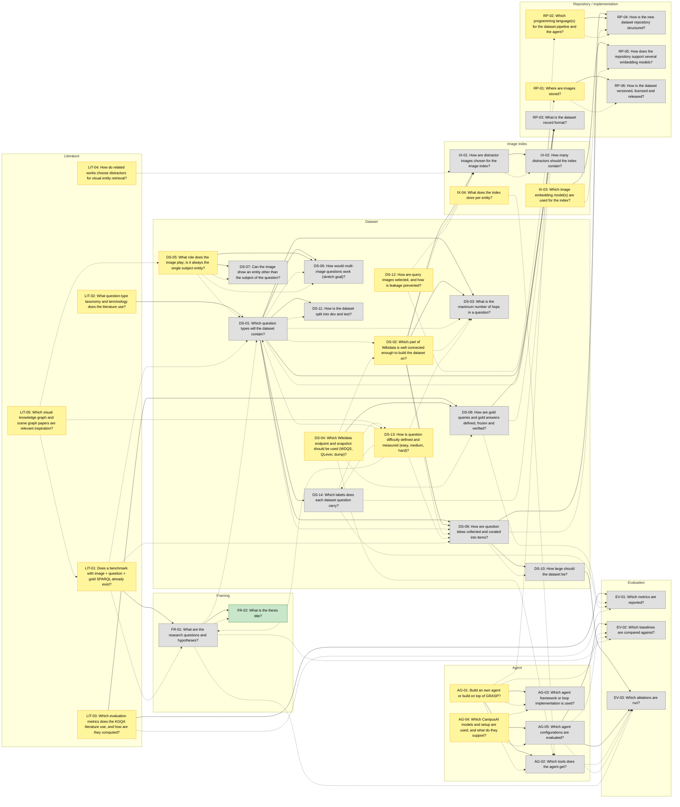

<!-- Generated by scripts/questions.py. Do not edit by hand; run `mise run questions`. -->

# Open questions

Index of the open questions and gaps of the thesis. Each question is a file in this
directory; its front matter (status, phase, priority, dependencies) drives this page.
See [`../THESIS.md`](../THESIS.md) for the overall description and
[`../decisions.md`](../decisions.md) for resolved decisions.

- **depends on**: hard dependency; the question cannot be settled before these are.
- **informs**: soft link; the answer shapes the other question.
- **ready**: not resolved and every hard dependency is `decided` or `dropped`.
- Order: phase (`dataset` first, it has a deadline), then priority, then how many
  questions it unblocks transitively. The *Unblocks* column lists direct dependents.

**39 questions:** 34 open, 4 researching, 1 decided, 0 dropped.

## Ready now

| ID | Question | Phase | Priority | Status | Unblocks |
| --- | --- | --- | --- | --- | --- |
| [LIT-02](LIT-02-question-type-taxonomy.md) | What question-type taxonomy and terminology does the literature use? | dataset | high | open | [DS-01](DS-01-question-types.md) |
| [DS-02](DS-02-wikidata-subset.md) | Which part of Wikidata is well connected enough to build the dataset on? | dataset | high | open | [DS-03](DS-03-hop-depth.md), [DS-09](DS-09-generation-pipeline.md), [IX-01](IX-01-distractor-strategy.md) |
| [AG-04](AG-04-gemma-hpc.md) | Which CampusAI models and setup are used, and what do they support? | dataset | high | researching | [AG-05](AG-05-experiment-configurations.md) |
| [LIT-03](LIT-03-kgqa-metrics.md) | Which evaluation metrics does the KGQA literature use, and how are they computed? | dataset | high | open | [DS-08](DS-08-gold-answers.md), [EV-01](EV-01-metrics.md) |
| [DS-04](DS-04-endpoint-snapshot.md) | Which Wikidata endpoint and snapshot should be used (WDQS, QLever, dump)? | dataset | high | open | [DS-08](DS-08-gold-answers.md) |
| [LIT-01](LIT-01-existing-image-sparql-benchmarks.md) | Does a benchmark with image + question + gold SPARQL already exist? | dataset | high | open | [FR-01](FR-01-research-questions.md) |
| [RP-01](RP-01-image-storage.md) | Where are images stored? | dataset | high | open | [RP-06](RP-06-dataset-versioning.md) |
| [RP-02](RP-02-languages.md) | Which programming language(s) for the dataset pipeline and the agent? | dataset | high | open | [RP-04](RP-04-repo-structure.md) |
| [DS-13](DS-13-difficulty-levels.md) | How is question difficulty defined and measured (easy, medium, hard)? | dataset | high | open | – |
| [DS-05](DS-05-image-role.md) | What role does the image play; is it always the single subject entity? | dataset | medium | researching | [DS-06](DS-06-multi-image-questions.md), [DS-07](DS-07-related-entity-images.md) |
| [DS-12](DS-12-query-images-and-leakage.md) | How are query images selected, and how is leakage prevented? | dataset | medium | open | – |
| [LIT-04](LIT-04-distractor-literature.md) | How do related works choose distractors for visual entity retrieval? | dataset | medium | open | – |
| [LIT-05](LIT-05-visual-knowledge-graphs.md) | Which visual knowledge graph and scene graph papers are relevant inspiration? | dataset | medium | open | – |
| [IX-03](IX-03-embedding-models.md) | Which image embedding model(s) are used for the index? | dataset | low | open | [RP-05](RP-05-multiple-embedding-models.md) |
| [IX-04](IX-04-index-payload.md) | What does the index store per entity? | dataset | low | open | – |
| [AG-01](AG-01-own-agent-vs-grasp.md) | Build an own agent or build on top of GRASP? | agent | medium | open | [AG-02](AG-02-tool-set.md), [AG-03](AG-03-agent-framework.md) |

## Blocked

| ID | Question | Phase | Priority | Waiting on |
| --- | --- | --- | --- | --- |
| [DS-01](DS-01-question-types.md) | Which question types will the dataset contain? | dataset | high | [LIT-02](LIT-02-question-type-taxonomy.md) |
| [DS-09](DS-09-generation-pipeline.md) | How are question ideas collected and curated into items? | dataset | high | [DS-01](DS-01-question-types.md), [DS-02](DS-02-wikidata-subset.md) |
| [DS-08](DS-08-gold-answers.md) | How are gold queries and gold answers defined, frozen and verified? | dataset | high | [LIT-03](LIT-03-kgqa-metrics.md), [DS-04](DS-04-endpoint-snapshot.md) |
| [IX-01](IX-01-distractor-strategy.md) | How are distractor images chosen for the image index? | dataset | high | [DS-02](DS-02-wikidata-subset.md) |
| [DS-10](DS-10-dataset-size.md) | How large should the dataset be? | dataset | medium | [DS-09](DS-09-generation-pipeline.md) |
| [FR-01](FR-01-research-questions.md) | What are the research questions and hypotheses? | dataset | medium | [LIT-01](LIT-01-existing-image-sparql-benchmarks.md) |
| [DS-03](DS-03-hop-depth.md) | What is the maximum number of hops in a question? | dataset | medium | [DS-01](DS-01-question-types.md), [DS-02](DS-02-wikidata-subset.md) |
| [DS-14](DS-14-question-labels.md) | Which labels does each dataset question carry? | dataset | medium | [DS-01](DS-01-question-types.md) |
| [IX-02](IX-02-distractor-count.md) | How many distractors should the index contain? | dataset | medium | [IX-01](IX-01-distractor-strategy.md) |
| [RP-03](RP-03-dataset-format.md) | What is the dataset record format? | dataset | medium | [DS-01](DS-01-question-types.md), [DS-08](DS-08-gold-answers.md) |
| [RP-04](RP-04-repo-structure.md) | How is the new dataset repository structured? | dataset | medium | [DS-09](DS-09-generation-pipeline.md), [RP-02](RP-02-languages.md) |
| [DS-06](DS-06-multi-image-questions.md) | How would multi-image questions work (stretch goal)? | dataset | low | [DS-01](DS-01-question-types.md), [DS-05](DS-05-image-role.md) |
| [DS-07](DS-07-related-entity-images.md) | Can the image show an entity other than the subject of the question? | dataset | low | [DS-05](DS-05-image-role.md) |
| [DS-11](DS-11-split-proportions.md) | How is the dataset split into dev and test? | dataset | low | [DS-01](DS-01-question-types.md) |
| [RP-05](RP-05-multiple-embedding-models.md) | How does the repository support several embedding models? | dataset | low | [IX-03](IX-03-embedding-models.md) |
| [RP-06](RP-06-dataset-versioning.md) | How is the dataset versioned, licensed and released? | dataset | low | [RP-01](RP-01-image-storage.md) |
| [AG-02](AG-02-tool-set.md) | Which tools does the agent get? | agent | high | [AG-01](AG-01-own-agent-vs-grasp.md) |
| [AG-05](AG-05-experiment-configurations.md) | Which agent configurations are evaluated? | agent | medium | [AG-04](AG-04-gemma-hpc.md) |
| [EV-01](EV-01-metrics.md) | Which metrics are reported? | agent | medium | [LIT-03](LIT-03-kgqa-metrics.md) |
| [EV-02](EV-02-baselines.md) | Which baselines are compared against? | agent | medium | [AG-05](AG-05-experiment-configurations.md) |
| [AG-03](AG-03-agent-framework.md) | Which agent framework or loop implementation is used? | agent | low | [AG-01](AG-01-own-agent-vs-grasp.md) |
| [EV-03](EV-03-ablations.md) | Which ablations are run? | agent | low | [DS-10](DS-10-dataset-size.md), [AG-05](AG-05-experiment-configurations.md) |

## Resolved

| ID | Question | Status |
| --- | --- | --- |
| [FR-02](FR-02-thesis-title.md) | What is the thesis title? | decided |

## By area

### Framing (FR)

| ID | Question | Status | Phase | Priority | Depends on | Informs |
| --- | --- | --- | --- | --- | --- | --- |
| [FR-01](FR-01-research-questions.md) | What are the research questions and hypotheses? | researching | dataset | medium | [LIT-01](LIT-01-existing-image-sparql-benchmarks.md) | [FR-02](FR-02-thesis-title.md), [DS-01](DS-01-question-types.md), [EV-02](EV-02-baselines.md), [EV-03](EV-03-ablations.md) |
| [FR-02](FR-02-thesis-title.md) | What is the thesis title? | decided | dataset | medium | [FR-01](FR-01-research-questions.md) | – |

### Literature (LIT)

| ID | Question | Status | Phase | Priority | Depends on | Informs |
| --- | --- | --- | --- | --- | --- | --- |
| [LIT-01](LIT-01-existing-image-sparql-benchmarks.md) | Does a benchmark with image + question + gold SPARQL already exist? | open | dataset | high | – | [FR-01](FR-01-research-questions.md), [DS-01](DS-01-question-types.md), [DS-09](DS-09-generation-pipeline.md) |
| [LIT-02](LIT-02-question-type-taxonomy.md) | What question-type taxonomy and terminology does the literature use? | open | dataset | high | – | – |
| [LIT-03](LIT-03-kgqa-metrics.md) | Which evaluation metrics does the KGQA literature use, and how are they computed? | open | dataset | high | – | [EV-01](EV-01-metrics.md) |
| [LIT-04](LIT-04-distractor-literature.md) | How do related works choose distractors for visual entity retrieval? | open | dataset | medium | – | [IX-01](IX-01-distractor-strategy.md) |
| [LIT-05](LIT-05-visual-knowledge-graphs.md) | Which visual knowledge graph and scene graph papers are relevant inspiration? | open | dataset | medium | – | [LIT-01](LIT-01-existing-image-sparql-benchmarks.md), [DS-05](DS-05-image-role.md), [DS-13](DS-13-difficulty-levels.md) |

### Dataset (DS)

| ID | Question | Status | Phase | Priority | Depends on | Informs |
| --- | --- | --- | --- | --- | --- | --- |
| [DS-01](DS-01-question-types.md) | Which question types will the dataset contain? | open | dataset | high | [LIT-02](LIT-02-question-type-taxonomy.md) | [DS-02](DS-02-wikidata-subset.md), [DS-03](DS-03-hop-depth.md), [DS-06](DS-06-multi-image-questions.md), [DS-09](DS-09-generation-pipeline.md), [DS-11](DS-11-split-proportions.md), [RP-03](RP-03-dataset-format.md) |
| [DS-02](DS-02-wikidata-subset.md) | Which part of Wikidata is well connected enough to build the dataset on? | open | dataset | high | – | [DS-03](DS-03-hop-depth.md), [DS-09](DS-09-generation-pipeline.md), [IX-01](IX-01-distractor-strategy.md) |
| [DS-03](DS-03-hop-depth.md) | What is the maximum number of hops in a question? | open | dataset | medium | [DS-01](DS-01-question-types.md), [DS-02](DS-02-wikidata-subset.md) | – |
| [DS-04](DS-04-endpoint-snapshot.md) | Which Wikidata endpoint and snapshot should be used (WDQS, QLever, dump)? | open | dataset | high | – | [DS-02](DS-02-wikidata-subset.md), [DS-08](DS-08-gold-answers.md), [AG-02](AG-02-tool-set.md) |
| [DS-05](DS-05-image-role.md) | What role does the image play; is it always the single subject entity? | researching | dataset | medium | – | [DS-01](DS-01-question-types.md), [DS-06](DS-06-multi-image-questions.md), [DS-07](DS-07-related-entity-images.md) |
| [DS-06](DS-06-multi-image-questions.md) | How would multi-image questions work (stretch goal)? | open | dataset | low | [DS-01](DS-01-question-types.md), [DS-05](DS-05-image-role.md) | – |
| [DS-07](DS-07-related-entity-images.md) | Can the image show an entity other than the subject of the question? | open | dataset | low | [DS-05](DS-05-image-role.md) | – |
| [DS-08](DS-08-gold-answers.md) | How are gold queries and gold answers defined, frozen and verified? | open | dataset | high | [LIT-03](LIT-03-kgqa-metrics.md), [DS-04](DS-04-endpoint-snapshot.md) | [RP-03](RP-03-dataset-format.md), [EV-01](EV-01-metrics.md) |
| [DS-09](DS-09-generation-pipeline.md) | How are question ideas collected and curated into items? | researching | dataset | high | [DS-01](DS-01-question-types.md), [DS-02](DS-02-wikidata-subset.md) | [DS-10](DS-10-dataset-size.md), [RP-04](RP-04-repo-structure.md) |
| [DS-10](DS-10-dataset-size.md) | How large should the dataset be? | open | dataset | medium | [DS-09](DS-09-generation-pipeline.md) | – |
| [DS-11](DS-11-split-proportions.md) | How is the dataset split into dev and test? | open | dataset | low | [DS-01](DS-01-question-types.md) | – |
| [DS-12](DS-12-query-images-and-leakage.md) | How are query images selected, and how is leakage prevented? | open | dataset | medium | – | [IX-01](IX-01-distractor-strategy.md), [RP-01](RP-01-image-storage.md) |
| [DS-13](DS-13-difficulty-levels.md) | How is question difficulty defined and measured (easy, medium, hard)? | open | dataset | high | – | [DS-01](DS-01-question-types.md), [DS-03](DS-03-hop-depth.md), [DS-09](DS-09-generation-pipeline.md), [DS-14](DS-14-question-labels.md), [FR-01](FR-01-research-questions.md) |
| [DS-14](DS-14-question-labels.md) | Which labels does each dataset question carry? | open | dataset | medium | [DS-01](DS-01-question-types.md) | [DS-13](DS-13-difficulty-levels.md), [RP-03](RP-03-dataset-format.md), [EV-01](EV-01-metrics.md) |

### Image index (IX)

| ID | Question | Status | Phase | Priority | Depends on | Informs |
| --- | --- | --- | --- | --- | --- | --- |
| [IX-01](IX-01-distractor-strategy.md) | How are distractor images chosen for the image index? | open | dataset | high | [DS-02](DS-02-wikidata-subset.md) | [IX-02](IX-02-distractor-count.md) |
| [IX-02](IX-02-distractor-count.md) | How many distractors should the index contain? | open | dataset | medium | [IX-01](IX-01-distractor-strategy.md) | – |
| [IX-03](IX-03-embedding-models.md) | Which image embedding model(s) are used for the index? | open | dataset | low | – | [RP-05](RP-05-multiple-embedding-models.md) |
| [IX-04](IX-04-index-payload.md) | What does the index store per entity? | open | dataset | low | – | [AG-02](AG-02-tool-set.md) |

### Agent (AG)

| ID | Question | Status | Phase | Priority | Depends on | Informs |
| --- | --- | --- | --- | --- | --- | --- |
| [AG-01](AG-01-own-agent-vs-grasp.md) | Build an own agent or build on top of GRASP? | open | agent | medium | – | [AG-02](AG-02-tool-set.md), [AG-03](AG-03-agent-framework.md), [RP-02](RP-02-languages.md), [EV-02](EV-02-baselines.md) |
| [AG-02](AG-02-tool-set.md) | Which tools does the agent get? | open | agent | high | [AG-01](AG-01-own-agent-vs-grasp.md) | [EV-03](EV-03-ablations.md) |
| [AG-03](AG-03-agent-framework.md) | Which agent framework or loop implementation is used? | open | agent | low | [AG-01](AG-01-own-agent-vs-grasp.md) | – |
| [AG-04](AG-04-gemma-hpc.md) | Which CampusAI models and setup are used, and what do they support? | researching | dataset | high | – | [AG-03](AG-03-agent-framework.md), [AG-05](AG-05-experiment-configurations.md) |
| [AG-05](AG-05-experiment-configurations.md) | Which agent configurations are evaluated? | open | agent | medium | [AG-04](AG-04-gemma-hpc.md) | [EV-02](EV-02-baselines.md), [EV-03](EV-03-ablations.md) |

### Evaluation (EV)

| ID | Question | Status | Phase | Priority | Depends on | Informs |
| --- | --- | --- | --- | --- | --- | --- |
| [EV-01](EV-01-metrics.md) | Which metrics are reported? | open | agent | medium | [LIT-03](LIT-03-kgqa-metrics.md) | – |
| [EV-02](EV-02-baselines.md) | Which baselines are compared against? | open | agent | medium | [AG-05](AG-05-experiment-configurations.md) | – |
| [EV-03](EV-03-ablations.md) | Which ablations are run? | open | agent | low | [DS-10](DS-10-dataset-size.md), [AG-05](AG-05-experiment-configurations.md) | – |

### Repository / implementation (RP)

| ID | Question | Status | Phase | Priority | Depends on | Informs |
| --- | --- | --- | --- | --- | --- | --- |
| [RP-01](RP-01-image-storage.md) | Where are images stored? | open | dataset | high | – | [RP-06](RP-06-dataset-versioning.md) |
| [RP-02](RP-02-languages.md) | Which programming language(s) for the dataset pipeline and the agent? | open | dataset | high | – | [RP-04](RP-04-repo-structure.md) |
| [RP-03](RP-03-dataset-format.md) | What is the dataset record format? | open | dataset | medium | [DS-01](DS-01-question-types.md), [DS-08](DS-08-gold-answers.md) | – |
| [RP-04](RP-04-repo-structure.md) | How is the new dataset repository structured? | open | dataset | medium | [DS-09](DS-09-generation-pipeline.md), [RP-02](RP-02-languages.md) | – |
| [RP-05](RP-05-multiple-embedding-models.md) | How does the repository support several embedding models? | open | dataset | low | [IX-03](IX-03-embedding-models.md) | – |
| [RP-06](RP-06-dataset-versioning.md) | How is the dataset versioned, licensed and released? | open | dataset | low | [RP-01](RP-01-image-storage.md) | – |

## Dependency graph

Solid arrow: hard dependency (`A --> B`: B depends on A). Dotted arrow: informs.
Green: resolved, yellow: ready, grey: blocked.

